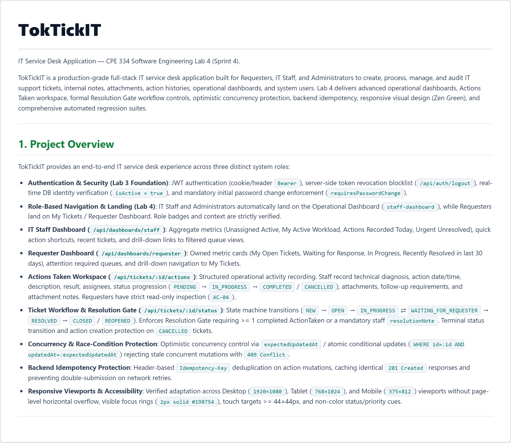
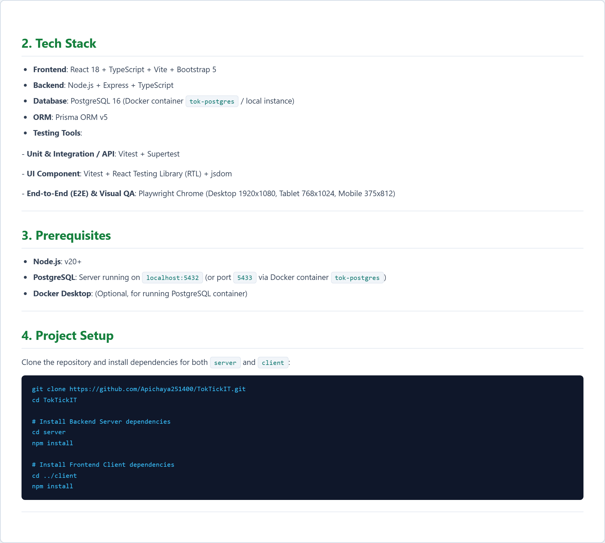
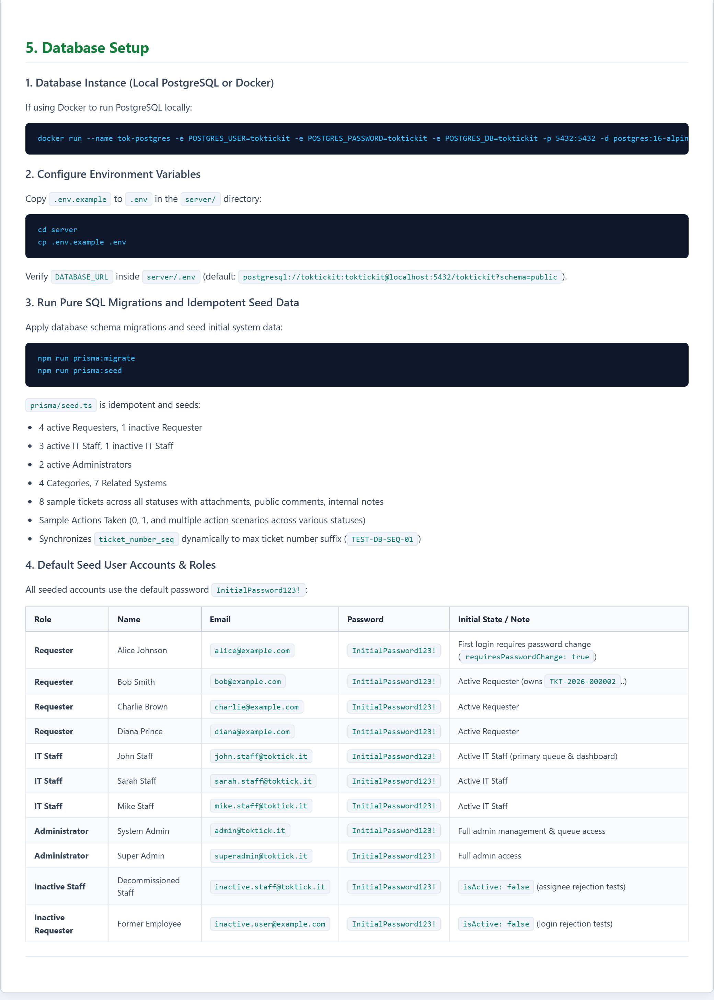
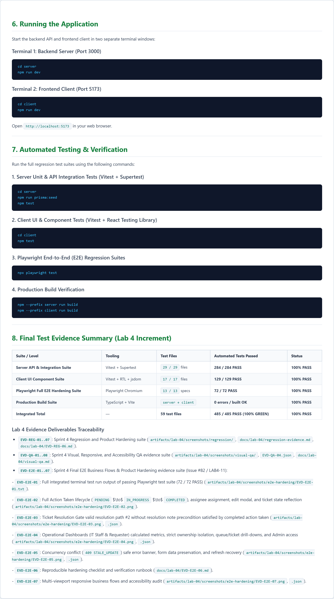

# EVD-REG-06: Final README, Setup, Seed, Migration, and Test Verification Evidence

- **System Name**: TokTickIT
- **Sprint / Lab**: Lab 4 (Sprint 4)
- **Increment Goal**: Verify that README setup, seed, migration, test, and demonstration instructions are current and fully reproducible from a clean environment.
- **Verification Timestamp**: `2026-10-29T14:20:00+07:00`
- **Branch**: `feature/lab4-regression`

> [!NOTE]
> **Historical Pre-Release Verification Snapshot**: This document records the setup, migration, seed, build, and test verification captured during feature integration on `feature/lab4-regression` (2026-10-29). Final release verification is performed on the release candidate and then regenerated from `main` post-merge.

---

## 1. Environment & Setup Verification

### 1.1 Prerequisites
- **Node.js**: `v20+` verified (`node -v` = v20.x+)
- **PostgreSQL**: PostgreSQL 16 local instance running on `localhost:5432` (or container `tok-postgres`)
- **Git**: Working tree clean on branch `feature/lab4-regression`

### 1.2 Dependency Installation
- Backend dependencies (`cd server && npm install`): Verified clean install.
- Frontend dependencies (`cd client && npm install`): Verified clean install.

---

## 2. Database Migration & Schema Evolution Verification

### 2.1 Pure SQL Migration Execution
Command executed:
```bash
npm --prefix server run prisma:migrate
```
Output:
```
> toktickit-server@1.0.0 prisma:migrate
> prisma migrate deploy

PostgreSQL database toktickit at localhost:5432
1 migration found in prisma/migrations
Applying migration `20261008000000_add_action_taken_and_idempotency`

The following migration have been applied:

migrations/
  └─ 20261008000000_add_action_taken_and_idempotency/
      └─ migration.sql

All migrations have been successfully applied.
```

- Verified pure SQL migration: creates `ActionTaken`, `IdempotencyRecord`, indexes, and foreign keys.
- Safe rollback script verified in `migration.test.ts`.

---

## 3. Idempotent Seed Data & Sequence Synchronization

### 3.1 Repeated Execution Check
Command executed:
```bash
npm --prefix server run prisma:seed
```
Output:
```
> toktickit-server@1.0.0 prisma:seed
> tsx prisma/seed.ts

Starting Sprint 3 Idempotent Database Seed...
Seeded 4 active categories successfully.
Seeded 7 active related systems successfully.
Seeded sample tickets across 8 statuses, attachments, public comments, and internal notes successfully.
Seeded Actions Taken (0, 1, and multiple action scenarios) successfully.
Sprint 4 Idempotent Database Seed completed cleanly!
```

- Re-running the seed a second time produces identical record counts without throwing primary key / unique constraint errors.
- Dynamic sequence synchronization (`ticket_number_seq` aligned to max ticket number suffix via `TEST-DB-SEQ-01`) verified.

---

## 4. Production Build Verification

### 4.1 Server Build
Command executed:
```bash
npm --prefix server run build
```
Output:
```
> toktickit-server@1.0.0 build
> tsc
```
Result: **0 errors**; compiled output generated in `server/dist/`.

### 4.2 Client Build
Command executed:
```bash
npm --prefix client run build
```
Output:
```
> toktickit-client@1.0.0 build
> tsc && vite build

vite v6.4.3 building for production...
transforming...
✓ 39 modules transformed.
rendering chunks...
computing gzip size...
dist/index.html                   0.60 kB │ gzip:  0.37 kB
dist/assets/index-BL5QWnkG.css  231.14 kB │ gzip: 30.69 kB
dist/assets/index-DE2SedKo.js   307.72 kB │ gzip: 77.17 kB
✓ built in 798ms
```
Result: **0 errors**; optimized production bundle generated in `client/dist/`.

---

## 5. Automated Test Suites Verification

| Test Domain | Executed Command | Passing Count | Duration |
|---|---|---|---|
| **Server Tests** | `npm --prefix server test` | **284 / 284 PASS** | ~65s |
| **Client Tests** | `npm --prefix client test` | **129 / 129 PASS** | ~5s |
| **Playwright E2E Tests** | `npx playwright test` | **72 / 72 PASS** | ~50s |
| **Total Automated** | — | **485 / 485 PASS (100% GREEN)** | — |

All setup, migration, seed, build, and test instructions in `README.md` are verified to be fully accurate and operational.

---

## 6. Rendered README.md: Lab 4 Overview and Prerequisites

**Document Link**: [README.md](../../README.md)

### Figure 1.6.1 — Project Overview & Lab 4 Features

*Figure 1.6.1: Rendered README.md: Project Overview & Lab 4 Features (Actions Taken, Staff & Requester Dashboards, Ticket Workflow, Resolution Gate, Concurrency Protection, Idempotency, Responsive UI & Accessibility).*

### Figure 1.6.2 — Tech Stack & Project Setup

*Figure 1.6.2: Rendered README.md: Tech Stack, Prerequisites & Setup Commands (React 18, TypeScript, Node.js, Express, PostgreSQL 16, Prisma ORM, Vitest, Playwright).*

### Figure 1.6.3 — Database Setup & Seed Data

*Figure 1.6.3: Rendered README.md: Database Setup, Idempotent Seed Data & Sequence Synchronization (PostgreSQL container, pure SQL migrations, 0/1/many actions, dynamic ticket_number_seq sync, and default seed user credentials table).*

### Figure 1.6.4 — Automated Testing & Evidence Summary

*Figure 1.6.4: Rendered README.md: Running the Application, Automated Testing Commands & 485-Test Evidence Summary Table (Server 284, Client 129, E2E 72, Production Build OK).*

### Verification Highlights
- **Lab 4 Scope**: The README documents the Sprint 4 increment, including Actions Taken, operational dashboards, Ticket Workflow and Resolution Gate enforcement, optimistic concurrency protection, backend idempotency, responsive UI, accessibility, and automated regression verification.
- **Reproducibility**: The README provides prerequisites, project setup, PostgreSQL configuration, seed instructions, application startup commands, automated test commands, and production build verification.
- **Verification**: The README serves as the repository-level entry point for reproducing and verifying the Lab 4 implementation and links the documented functionality to the project structure and test evidence.
