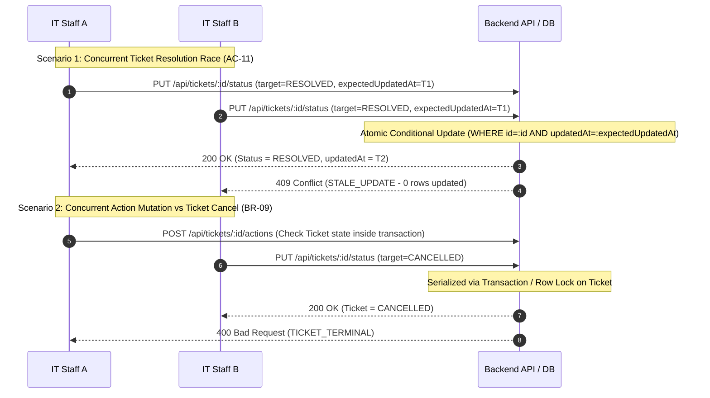

# Sprint 4 Engineering Test Strategy & Traceability Matrix: TokTickIT Actions Taken, Role Dashboards, Final Workflow, and Product Hardening

- **System Name**: TokTickIT
- **Sprint / Lab**: Lab 4 (Sprint 4)
- **Document Status**: Approved Engineering Test Strategy & Traceability Matrix
- **Repository Branch**: `feature/lab4-e2e-hardening`

---

## 1. Executive Summary & Test Strategy Scope

This document establishes the authoritative Test Strategy and Requirement Traceability Matrix for **TokTickIT Lab 4 (Sprint 4)**. Every Functional Requirement (**FR-01** to **FR-15**), Business Rule (**BR-01** to **BR-17**), Acceptance Criterion (**AC-01** to **AC-23**), and Dashboard Metric Card is mapped to concrete, executable unit, integration/API, client UI component, responsive, accessibility, performance-smoke, or Playwright E2E tests adhering strictly to the SE Lab 4 Handout Minimum Structure and Master Workflow guidelines.

### Test Strategy Principles
1. **Zero Unmapped Criteria**: 100% of Acceptance Criteria, Functional Requirements, Business Rules, and Handout Data Model requirements have at least one explicit automated or manual test case.
2. **Explicit Migration & Idempotent Seed Testing**: Database migration preservation (`TEST-DB-02`) guarantees zero data loss for Lab 1–3 Users, Tickets, Comments, Notes, and Attachments while supporting legacy 0-action tickets. Idempotent seed testing (`TEST-DB-03`) verifies sequential double-seed execution without duplicate creation.
3. **Explicit Attachment Notes & UI Style Coverage**: Persistence of `attachmentNotes` (`TEST-ACT-09`) and client card rendering (`TEST-UI-ACT-03`) are explicitly tested alongside Zen Green visual style consistency (`TEST-STYLE-01`).
4. **Form Data Preservation & Safe Recoverable Failures**: Action Taken submission failures trigger safe alert feedback while preserving user-entered form data for retry (`TEST-FAIL-01`) reusing the client `Idempotency-Key` (`TEST-IDEM-03`).
5. **Real Concurrency & Server Enforcement**: Race conditions, optimistic concurrency control (`expectedUpdatedAt`), and header-based backend idempotency (`Idempotency-Key`) are tested using parallel execution (`Promise.all`) against real database transactions.
6. **Full Lab 1–3 Regression Preservation**: Automated test suites guarantee 100% pass rate across all existing Lab 1, Lab 2, and Lab 3 functionality using verified repository CLI commands (`npm --prefix server test`, `npm --prefix client test`, `npx playwright test`).

---

## 2. Requirement-to-Test Traceability Matrix

### 2.1 Test ID Semantic Separation Notice
- **`TEST-DASH-*` (Backend Query & API Contract Tests)**: Target `server/tests/lab-04/staff-dashboard.api.test.ts`. Verifies backend Prisma aggregate query calculation accuracy, Asia/Bangkok (UTC+7) date boundary filtering, role authorization, and JSON response payloads.
- **`TEST-CARD-*` (UI Presentation & Drill-Down Tests)**: Target `client/tests/lab-04/StaffDashboard.test.tsx` and `RequesterDashboard.test.tsx`. Verifies client UI card rendering, helper subtext, empty state `0` displays, and interactive drill-down URL navigation.

### 2.2 Functional Requirements (FR) Traceability Summary Table

| Requirement ID | Requirement Summary | Mapped Acceptance Criteria & Business Rules | Planned Test IDs |
|---|---|---|---|
| **FR-01** | Parent-child `ActionTaken` 1:N relationship under Ticket | AC-01, AC-05, BR-01 | `TEST-ACT-01`, `TEST-ACT-05`, `TEST-DB-01` |
| **FR-02** | Automatic performer attribution (`performedById = req.user.id`) | AC-01, AC-02, BR-03 | `TEST-ACT-01`, `TEST-ACT-02` |
| **FR-03** | Mandatory `followUpNote` when `followUpRequired = true` | AC-03, BR-05 | `TEST-ACT-03` |
| **FR-04** | IT Staff/Admin Action creation & management; Requester read-only; Terminal state block | AC-04, AC-18, AC-22, BR-04, BR-06, BR-09 | `TEST-ACT-04`, `TEST-TERM-02`, `TEST-TERM-03`, `TEST-ACT-07` |
| **FR-05** | IT Staff Dashboard backend metrics & drill-down | AC-06, AC-08, BR-13, BR-15 | `TEST-DASH-01`, `TEST-DASH-03`, `TEST-CARD-01..06` |
| **FR-06** | Requester Dashboard backend metrics & drill-down | AC-07, BR-13, BR-15 | `TEST-DASH-02`, `TEST-CARD-07..12` |
| **FR-07** | Authoritative backend queries & Asia/Bangkok (UTC+7) time boundaries | BR-11, BR-12 | `TEST-DASH-05`, `TEST-UNIT-02` |
| **FR-08** | Graceful zero-count metric rendering | AC-15, BR-14 | `TEST-DASH-04` (API), `TEST-CARD-00` (UI) |
| **FR-09** | Enforce 8 Ticket workflow statuses & state transitions | Section 8.1, AC-09, AC-12, BR-08, BR-09 | `TEST-FLOW-01..06`, `TEST-FLOW-CYCLE-01`, `TEST-TERM-01` |
| **FR-10** | Server-side Resolution Gate rule | AC-09, BR-08 | `TEST-GATE-01`, `TEST-FLOW-03..05` |
| **FR-11** | Safe error responses for invalid transitions & authorization | AC-02, AC-03, AC-04, AC-21, AC-23, BR-16 | `TEST-ACT-02`, `TEST-ACT-03`, `TEST-ACT-04`, `TEST-ACT-06`, `TEST-SEC-01` |
| **FR-12** | Concurrent & stale update detection (`409 Conflict`) | AC-11, AC-17, BR-10 | `TEST-CONCUR-01`, `TEST-CONCUR-02` |
| **FR-13** | Lab 1–3 data & feature preservation | AC-13 | `TEST-REGR-01`, `TEST-DB-02` |
| **FR-14** | Debouncing & backend `Idempotency-Key` duplicate protection | AC-16, AC-20 | `TEST-IDEM-01`, `TEST-IDEM-02`, `TEST-IDEM-03` |
| **FR-15** | Responsive & accessibility compliance | AC-14, AC-19 | `TEST-RESP-01`, `TEST-A11Y-01`, `TEST-STYLE-01` |

### 2.3 Business Rules (BR) Traceability Summary Table

| Rule ID | Rule Summary | Mapped Acceptance Criteria | Planned Test IDs | Target Test File |
|---|---|---|---|---|
| **BR-01** | ActionTaken belongs to exactly 1 Ticket | AC-01 | `TEST-DB-01` | `server/tests/lab-04/db-schema.test.ts` |
| **BR-02** | Ticket Owner vs Action Performer separation | AC-05 | `TEST-ACT-08` | `server/tests/lab-04/actions-taken.api.test.ts` |
| **BR-03** | Performer ID derived strictly from actor session token | AC-02 | `TEST-ACT-02` | `server/tests/lab-04/actions-taken.api.test.ts` |
| **BR-04** | Action assignee must be active IT Staff or Administrator | AC-21 | `TEST-ACT-06` | `server/tests/lab-04/actions-taken.api.test.ts` |
| **BR-05** | `followUpNote` mandatory when `followUpRequired = true` | AC-03 | `TEST-ACT-03` | `server/tests/lab-04/actions-taken.api.test.ts` |
| **BR-06** | Requester read-only access for Actions Taken | AC-04 | `TEST-ACT-04` | `server/tests/lab-04/actions-taken.api.test.ts` |
| **BR-07** | Requester "Problem Appears Resolved" indication is advisory | AC-10 | `TEST-GATE-02` | `server/tests/lab-04/ticket-workflow.api.test.ts` |
| **BR-08** | Resolution Gate evaluation (>= 1 COMPLETED or note) | AC-09 | `TEST-GATE-01` | `server/tests/lab-04/ticket-workflow.api.test.ts` |
| **BR-09** | Terminal `CANCELLED` status locks transitions & actions | AC-12, AC-18 | `TEST-TERM-01..03` | `server/tests/lab-04/ticket-workflow.api.test.ts` & `actions-taken.api.test.ts` |
| **BR-10** | Optimistic concurrency via mandatory `expectedUpdatedAt` | AC-11, AC-17 | `TEST-CONCUR-01..02` | `server/tests/lab-04/concurrency.api.test.ts` |
| **BR-11** | Dashboard metrics calculated server-side | AC-06, AC-07 | `TEST-DASH-05` | `server/tests/lab-04/staff-dashboard.api.test.ts` |
| **BR-12** | Asia/Bangkok (UTC+7) time boundary calculations | AC-06, AC-07 | `TEST-UNIT-02` | `server/tests/unit/timezone.test.ts` |
| **BR-13** | Ownership-scoped dashboard metric filtering | AC-06, AC-07 | `TEST-DASH-06` | `server/tests/lab-04/staff-dashboard.api.test.ts` |
| **BR-14** | Explicit empty state `0` behavior for metric cards | AC-15 | `TEST-CARD-00` | `client/tests/lab-04/StaffDashboard.test.tsx` |
| **BR-15** | Metric card click drill-down navigation | AC-08 | `TEST-DASH-03` | `e2e/lab-04/staff-dashboard.spec.ts` |
| **BR-16** | ActionTaken authorization bound to parent Ticket | AC-23 | `TEST-SEC-01` | `server/tests/lab-04/actions-taken.api.test.ts` |
| **BR-17** | Whitespace-only string rejection on textual inputs | AC-03, AC-09 | `TEST-UNIT-03` | `server/tests/unit/validation.test.ts` |

### 2.4 Acceptance Criteria (AC) & Metric Traceability Matrix

| Requirement / AC ID | Category / Description | Planned Test ID | Test Type | Target File / Execution Path | Expected Result | Status |
|---|---|---|---|---|---|---|
| **AC-01 / FR-01, FR-02** | Create Action Taken with valid data & auto performer attribution | `TEST-ACT-01` | Integration / API | `server/tests/lab-04/actions-taken.api.test.ts` | `201 Created`, action linked to ticket, `performedById = req.user.id` | `Pass` |
| **AC-02 / BR-03** | Reject client-supplied performer ID in request payload | `TEST-ACT-02` | Integration / API | `server/tests/lab-04/actions-taken.api.test.ts` | `400 Bad Request` (`INVALID_PERFORMER_ATTRIBUTE`) | `Pass` |
| **AC-03 / FR-03, BR-05** | Reject `followUpRequired = true` when `followUpNote` is empty/whitespace | `TEST-ACT-03` | Integration / API | `server/tests/lab-04/actions-taken.api.test.ts` | `400 Bad Request` (`MISSING_FOLLOW_UP_NOTE`) | `Pass` |
| **AC-04 / BR-06** | Reject Requester attempting `POST` / `PUT` on ActionTaken | `TEST-ACT-04` | Integration / API | `server/tests/lab-04/actions-taken.api.test.ts` | `403 Forbidden` (`FORBIDDEN`) | `Pass` |
| **AC-05 / FR-01** | Multi-staff actions ordered chronologically (`createdAt ASC`, `id ASC`) | `TEST-ACT-05` | Integration / API | `server/tests/lab-04/actions-taken.api.test.ts` | `200 OK`, returned list strictly sorted by `createdAt ASC`, tie-break `id ASC` | `Pass` |
| **AC-06 / FR-05** | IT Staff Dashboard calculates accurate metrics, urgent & recent items | `TEST-DASH-01` | Integration / API | `server/tests/lab-04/staff-dashboard.api.test.ts` | `200 OK`, exact aggregate counts for `unassignedCount`, `myAssignedCount`, `todayActionsCount`, `urgentWorkloadCount` | `Pass` |
| **AC-06 / FR-05** | Administrator can access dashboard and IT queue endpoints | `TEST-DASH-ADMIN-01` | Integration / API | `server/tests/lab-04/staff-dashboard.api.test.ts` | `200 OK`, Administrator receives dashboard metrics and queue tickets without 403 Forbidden | `Pass` |
| **AC-06 / FR-05** | Administrator dashboard Today's Actions drill-down query | `TEST-DASH-ADMIN-02` | Integration / API | `server/tests/lab-04/staff-dashboard.api.test.ts` | `200 OK`, Administrator queries `/api/tickets?view=today_actions` returning performed actions | `Pass` |
| **AC-07 / FR-06** | Requester Dashboard calculates accurate owned metrics & attention items | `TEST-DASH-02` | Integration / API & UI | `server/tests/lab-04/requester-dashboard.api.test.ts` & `client/tests/lab-04/RequesterDashboard.test.tsx` (E2E: `requester-dashboard.spec.ts`) | `200 OK`, exact aggregate counts for `openTicketsCount`, `waitingForRequesterCount`, `inProgressCount`, `recentlyResolvedCount` | `Pass` |
| **AC-08 / BR-15** | IT Staff Dashboard metric card click navigates to filtered staff queue | `TEST-DASH-03` | Playwright E2E | `e2e/lab-04/staff-dashboard.spec.ts` | Clicking metric card navigates to target staff queue URL (e.g. `/staff/queue?view=unassigned_active`) | `Pass` |
| **AC-08 / BR-15** | Unassigned Active drill-down excludes CLOSED / RESOLVED tickets | `TEST-DASH-DRILL-01` | Integration / API | `server/tests/lab-04/staff-dashboard.api.test.ts` | `200 OK`, `view=unassigned_active` returns only active open unassigned tickets | `Pass` |
| **AC-08 / BR-15** | My Queue Active drill-down excludes RESOLVED / CLOSED tickets | `TEST-DASH-DRILL-02` | Integration / API | `server/tests/lab-04/staff-dashboard.api.test.ts` | `200 OK`, `view=my_queue_active` returns only active tickets assigned to current user | `Pass` |
| **AC-08 / BR-15** | Urgent Workload drill-down excludes non-actionable statuses | `TEST-DASH-DRILL-03` | Integration / API | `server/tests/lab-04/staff-dashboard.api.test.ts` | `200 OK`, `view=urgent_workload` returns only urgent tickets in `NEW`, `OPEN`, `IN_PROGRESS` | `Pass` |
| **AC-08 / BR-15** | Administrator Dashboard load & drill-down to queue without 403 | `E2E-STAFFDASH-07` | Playwright E2E | `e2e/lab-04/staff-dashboard.spec.ts` | Administrator accesses dashboard, drills down to `/staff/queue` without 403; Requester denied access | `Pass` |
| **AC-09 / FR-10, BR-08** | Resolution Gate blocks resolving `IN_PROGRESS` ticket with 0 completed actions & empty note | `TEST-GATE-01` | Integration / API | `server/tests/lab-04/ticket-workflow.api.test.ts` | `400 Bad Request` (`BAD_REQUEST`) | `Pass` |
| **AC-10 / BR-07** | Requester "Problem Appears Resolved" indication records timestamp, status unchanged | `TEST-GATE-02` | Integration / API | `server/tests/lab-04/ticket-workflow.api.test.ts` | `200 OK`, `requesterResolvedIndicatedAt` set, `currentStatus` remains `IN_PROGRESS` | `Pass` |
| **AC-11 / BR-10** | Concurrent ticket resolution race condition using same `expectedUpdatedAt` | `TEST-CONCUR-01` | Integration / API | `server/tests/lab-04/concurrency.api.test.ts` | Concurrent `Promise.all`: exactly 1 request gets `200 OK`, competing request gets `409 Conflict` (`STALE_UPDATE`) | `Pass` |
| **AC-12 / BR-09** | Reject status transition on `CANCELLED` ticket | `TEST-TERM-01` | Integration / API | `server/tests/lab-04/ticket-workflow.api.test.ts` | `400 Bad Request` (`TICKET_TERMINAL`) | `Pass` |
| **AC-12 / BR-09** | Reject Action creation on `CANCELLED` ticket | `TEST-TERM-02` | Integration / API | `server/tests/lab-04/actions-taken.api.test.ts` & `ticket-workflow.api.test.ts` | `400 Bad Request` (`TICKET_TERMINAL`) | `Pass` |
| **AC-12 / BR-09** | Reject Action edit or status transition on `CANCELLED` ticket | `TEST-TERM-03` | Integration / API | `server/tests/lab-04/actions-taken.api.test.ts` | `400 Bad Request` (`TICKET_TERMINAL`) | `Pass` |
| **AC-13 / FR-13** | Full Lab 1–3 regression test suite verification | `TEST-REGR-01` | E2E & API | `npm --prefix server test` & `npx playwright test` | 100% of Lab 1–3 server and E2E regression tests pass cleanly | `Pass` |
| **AC-14 / FR-15** | Visual Responsive Layout Adaptation across Desktop, Tablet, and Mobile viewports | `TEST-RESP-01` | Playwright E2E | `e2e/lab-04/responsive-a11y.spec.ts` | Viewports `1920×1080`, `768×1024`, `375×812` render grid, table, and cards without clipping/overflow | `Pass` |
| **AC-15 / FR-08, BR-14** | Zero-count metric API payload response validation | `TEST-DASH-04` | Integration / API | `server/tests/lab-04/staff-dashboard.api.test.ts` | Endpoint returns `0` counts for empty datasets in JSON payload | `Pass` |
| **AC-15 / FR-08, BR-14** | Zero-count metric UI card rendering & empty state text | `TEST-CARD-00` | UI Component | `client/tests/lab-04/StaffDashboard.test.tsx` | Metric cards render `0` and empty lists render clean message (e.g. `"No recent tickets"`) | `Pass` |
| **AC-16 / FR-14** | Duplicate ActionTaken creation with identical `Idempotency-Key` returns cached response | `TEST-IDEM-01` | Integration / API | `server/tests/lab-04/idempotency.api.test.ts` | `201 Created`, cached response returned, exactly 1 ActionTaken record created in database | `Pass` |
| **AC-17 / BR-10, FR-12** | Stale ActionTaken or Ticket update using outdated `expectedUpdatedAt` | `TEST-CONCUR-02` | Integration / API | `server/tests/lab-04/concurrency.api.test.ts` | `409 Conflict` (`STALE_UPDATE`), database state unmodified by stale request | `Pass` |
| **AC-18 / BR-09, FR-04** | ActionTaken creation attempt on `CANCELLED` ticket | `TEST-TERM-02` | Integration / API | `server/tests/lab-04/actions-taken.api.test.ts` & `ticket-workflow.api.test.ts` | `400 Bad Request` (`TICKET_TERMINAL`), zero actions added | `Pass` |
| **AC-19 / FR-15** | Interactive Accessibility: keyboard navigation, focus ring, ARIA, touch targets | `TEST-A11Y-01` | Playwright E2E | `e2e/lab-04/responsive-a11y.spec.ts` | Visible focus rings (`2px solid #198754`), valid ARIA roles, touch targets >= 44×44px, no body horizontal overflow | `Pass` |
| **AC-20 / FR-14** | Reuse existing `Idempotency-Key` with different request payload | `TEST-IDEM-02` | Integration / API | `server/tests/lab-04/idempotency.api.test.ts` | `409 Conflict` (`IDEMPOTENCY_KEY_REUSED`), zero new records created | `Pass` |
| **AC-21 / BR-04** | Assign action to inactive user, non-staff user, or invalid UUID | `TEST-ACT-06` | Integration / API | `server/tests/lab-04/actions-taken.api.test.ts` | `400 Bad Request` (`INVALID_ASSIGNEE`) | `Pass` |
| **AC-22 / Section 8.2** | Valid action status transitions pass; invalid transitions from terminal states fail | `TEST-ACT-07` | Integration / API | `server/tests/lab-04/actions-taken.api.test.ts` | Permitted status transitions return `200 OK`; terminal `COMPLETED`/`CANCELLED` status changes return `400 Bad Request` | `Pass` |
| **AC-23 / BR-16** | Cross-ticket ActionTaken access authorization check (unauthorized ticket) | `TEST-SEC-01` | Integration / API | `server/tests/lab-04/actions-taken.api.test.ts` | `403 Forbidden` (`FORBIDDEN`), ActionTaken access bound strictly to parent Ticket authorization | `Pass` |
| **Handout §4.1** | `Attachment Notes` API persistence on Action Taken | `TEST-ACT-09` | Integration / API | `server/tests/lab-04/actions-taken.api.test.ts` | `201 Created`, `attachmentNotes` field stored in DB and returned in JSON response | `Pass` |
| **Handout §4.1** | `Attachment Notes` UI rendering in Actions Taken Workspace | `TEST-UI-ACT-03` | UI Component | `client/tests/lab-04/ActionsTaken.test.tsx` | Card renders `attachmentNotes` string and attachment reference icon | `Pass` |
| **Handout §4.1** | Database Migration & Backfill Data Preservation | `TEST-DB-02` | Integration / DB | `server/tests/lab-04/migration.test.ts` | Preserves all Lab 1–3 Users, Tickets, Comments, Notes, Attachments; legacy tickets have 0 actions | `Pass` |
| **Handout §4.1** | Idempotent Seed Execution Verification | `TEST-DB-03` | Integration / DB | `server/tests/lab-04/seed.test.ts` | Sequential double seed execution creates zero duplicates; produces 0/1/many action tickets | `Pass` |
| **Handout §5.2** | Recoverable Action Submission Failure & Form Data Preservation | `TEST-FAIL-01` | UI Component | `client/tests/lab-04/ActionsTaken.test.tsx` | On 500/network error, UI displays alert banner while preserving user-entered description/result/notes | `Pass` |
| **Handout §5.2** | Client Retry with original `Idempotency-Key` after network failure | `TEST-IDEM-03` | E2E & API | `e2e/lab-04/actions-taken-flow.spec.ts` | Retry submission sends identical `Idempotency-Key` header preventing duplicate DB record creation | `Pass` |
| **Handout §9** | Zen Green Visual Theme, Badge Styling & Non-color Status Cues | `TEST-STYLE-01` | UI Component | `client/tests/lab-04/ActionsTaken.test.tsx` | Verifies `#198754` brand accents, priority/status badge color classes, and text/icon non-color cues | `Pass` |
| **BR-01** | ActionTaken foreign key database constraint binding to Ticket | `TEST-DB-01` | Integration / Database | `server/tests/lab-04/db-schema.test.ts` | Database foreign key constraint enforces `ticketId` binding; invalid `ticketId` throws FK error | `Pass` |
| **BR-02** | Ticket Owner vs Action Performer separation | `TEST-ACT-08` | Integration / API | `server/tests/lab-04/actions-taken.api.test.ts` | Action created by Staff B on Ticket owned by Staff A records `performedById = Staff B` | `Pass` |
| **BR-11** | Dashboard metrics calculated server-side | `TEST-DASH-05` | Integration / API | `server/tests/lab-04/staff-dashboard.api.test.ts` | Endpoint returns aggregate totals directly without returning raw item arrays | `Pass` |
| **BR-12** | Fixed Asia/Bangkok (UTC+7) time boundary calculation | `TEST-UNIT-02` | Unit Test | `server/tests/unit/timezone.test.ts` | `startOfDay` and `startOfNextDay` calculate boundaries in Asia/Bangkok local time | `Pass` |
| **BR-13** | Ownership-scoped metrics filter strictly by `req.user.id` | `TEST-DASH-06` | Integration / API | `server/tests/lab-04/staff-dashboard.api.test.ts` | Staff dashboard filters `ownerId = req.user.id`; Requester dashboard filters `requesterId = req.user.id` | `Pass` |
| **BR-17** | Whitespace-only string rejection on textual fields | `TEST-UNIT-03` | Unit Test | `server/tests/unit/validation.test.ts` | Validation trims whitespace; `"   "` is treated as empty and returns `400 Bad Request` | `Pass` |
| **Metric: Unassigned Tickets** | IT Staff Dashboard aggregate card | `TEST-CARD-01` | API & UI | `server/tests/lab-04/staff-dashboard.api.test.ts` & `client/tests/lab-04/StaffDashboard.test.tsx` (E2E: `staff-dashboard.spec.ts`) | Counts open tickets with `ownerId IS NULL`; click navigates to `/staff/queue?owner=unassigned` | `Pass` |
| **Metric: My Assigned Tickets** | IT Staff Dashboard aggregate card | `TEST-CARD-02` | API & UI | `server/tests/lab-04/staff-dashboard.api.test.ts` & `client/tests/lab-04/StaffDashboard.test.tsx` (E2E: `staff-dashboard.spec.ts`) | Counts open tickets with `ownerId = req.user.id`; click navigates to `/staff/queue?owner=my_queue` | `Pass` |
| **Metric: Today's Actions** | IT Staff Dashboard aggregate card | `TEST-CARD-03` | API & UI | `server/tests/lab-04/staff-dashboard.api.test.ts` & `client/tests/lab-04/StaffDashboard.test.tsx` (E2E: `staff-dashboard.spec.ts`) | Counts actions recorded today by current staff in UTC+7; click navigates to `/staff/queue?view=today_actions` | `Pass` |
| **Metric: Urgent Workload** | IT Staff Dashboard aggregate card | `TEST-CARD-04` | API & UI | `server/tests/lab-04/staff-dashboard.api.test.ts` & `client/tests/lab-04/StaffDashboard.test.tsx` (E2E: `staff-dashboard.spec.ts`) | Counts urgent tickets needing staff action; click navigates to `/staff/queue?itPriority=URGENT` | `Pass` |
| **Section: My Recent Tickets** | IT Staff Dashboard workload list | `TEST-CARD-05` | API & UI | `server/tests/lab-04/staff-dashboard.api.test.ts` & `client/tests/lab-04/StaffDashboard.test.tsx` (E2E: `staff-dashboard.spec.ts`) | Returns max 5 tickets assigned to user ordered by `updatedAt DESC, id ASC` | `Pass` |
| **Section: Current Staff Actions** | IT Staff Dashboard action feed | `TEST-CARD-06` | API & UI | `server/tests/lab-04/staff-dashboard.api.test.ts` & `client/tests/lab-04/StaffDashboard.test.tsx` (E2E: `staff-dashboard.spec.ts`) | Returns max 5 actions performed by user ordered by `createdAt DESC, id ASC` | `Pass` |
| **Metric: My Open Tickets** | Requester Dashboard aggregate card | `TEST-CARD-07` | API & UI | `server/tests/lab-04/requester-dashboard.api.test.ts` & `client/tests/lab-04/RequesterDashboard.test.tsx` (E2E: `requester-dashboard.spec.ts`) | Counts open tickets owned by requester; click navigates to `/tickets/my-tickets?currentStatus=open` | `Pass` |
| **Metric: Waiting for My Response** | Requester Dashboard aggregate card | `TEST-CARD-08` | API & UI | `server/tests/lab-04/requester-dashboard.api.test.ts` & `client/tests/lab-04/RequesterDashboard.test.tsx` (E2E: `requester-dashboard.spec.ts`) | Counts requester tickets in `WAITING_FOR_REQUESTER`; click navigates to `/tickets/my-tickets?currentStatus=WAITING_FOR_REQUESTER` | `Pass` |
| **Metric: In Progress** | Requester Dashboard aggregate card | `TEST-CARD-09` | API & UI | `server/tests/lab-04/requester-dashboard.api.test.ts` & `client/tests/lab-04/RequesterDashboard.test.tsx` (E2E: `requester-dashboard.spec.ts`) | Counts requester tickets in `IN_PROGRESS`; click navigates to `/tickets/my-tickets?currentStatus=IN_PROGRESS` | `Pass` |
| **Metric: Recently Resolved** | Requester Dashboard aggregate card | `TEST-CARD-10` | API & UI | `server/tests/lab-04/requester-dashboard.api.test.ts` & `client/tests/lab-04/RequesterDashboard.test.tsx` (E2E: `requester-dashboard.spec.ts`) | Counts resolved tickets in current day + past 29 calendar days using `updatedAt` in UTC+7; click navigates to `/tickets/my-tickets?currentStatus=RESOLVED&resolvedWithinDays=30` | `Pass` |
| **BR-12 / AC-07** | Requester My Tickets 30-day resolved query parameter enforcement | `TEST-DASH-REQ-10` | Integration / API | `server/tests/lab-04/requester-dashboard.api.test.ts` | Validates `resolvedWithinDays=30` requires `currentStatus=RESOLVED` and filters Bangkok 30-day window (`updatedAt >= startOfDay AND updatedAt < startOfNextDay`) | `Pass` |
| **Section: Recent Tickets** | Requester Dashboard ticket list | `TEST-CARD-11` | API & UI | `server/tests/lab-04/requester-dashboard.api.test.ts` & `client/tests/lab-04/RequesterDashboard.test.tsx` (E2E: `requester-dashboard.spec.ts`) | Returns max 5 requester tickets ordered by `updatedAt DESC, id ASC` | `Pass` |
| **Section: Attention Required** | Requester Dashboard action list | `TEST-CARD-12` | API & UI | `server/tests/lab-04/requester-dashboard.api.test.ts` & `client/tests/lab-04/RequesterDashboard.test.tsx` (E2E: `requester-dashboard.spec.ts`) | Returns max 5 tickets in `WAITING_FOR_REQUESTER` ordered by `updatedAt DESC, id ASC` | `Pass` |
| **Product Hardening / Issue #80** | Browser Console Errors QA | `TEST-HARDEN-01` | Playwright E2E | `e2e/lab-04/final-product-hardening.spec.ts` | Zero unhandled console errors and zero page exceptions across all views | `Pass` |
| **Product Hardening / Issue #80** | Internal Hyperlinks QA | `TEST-HARDEN-02` | Playwright E2E | `e2e/lab-04/final-product-hardening.spec.ts` | Zero broken relative `<a>` links or 4xx/5xx targets; actual links verified | `Pass` |
| **Product Hardening / Issue #80** | Placeholder Text QA | `TEST-HARDEN-03` | Playwright E2E | `e2e/lab-04/final-product-hardening.spec.ts` | Zero `TODO`, `TBD`, `Lorem ipsum`, `Coming Soon`, or `Not Implemented` text | `Pass` |
| **Product Hardening / Issue #80** | Interactive Controls QA | `TEST-HARDEN-04` | Playwright E2E | `e2e/lab-04/final-product-hardening.spec.ts` | All interactive buttons have functional behaviors, valid labels, and 0 dead placeholder controls | `Pass` |
| **Visual QA / Issue #81** | Desktop Viewport Inspection (`1920×1080` - `EVD-QA-01`) | `TEST-QA-01` | Playwright E2E | `e2e/lab-04/visual-accessibility-qa.spec.ts` | All 8 major and preserved screens inspected with 0 horizontal overflow and no clipping | `Pass` |
| **Visual QA / Issue #81** | Tablet Viewport Inspection (`768×1024` - `EVD-QA-02`) | `TEST-QA-02` | Playwright E2E | `e2e/lab-04/visual-accessibility-qa.spec.ts` | Responsive 2×2 metric grids, table scroll wrappers, 0 body overflow | `Pass` |
| **Visual QA / Issue #81** | Mobile Viewport Inspection (`375×812` - `EVD-QA-03`) | `TEST-QA-02-MOB` | Playwright E2E | `e2e/lab-04/visual-accessibility-qa.spec.ts` | Single-column stacks, touch targets >= 44×44px, 0 horizontal overflow | `Pass` |
| **Visual QA / Issue #81** | Rendered UI Specification Evidence (`EVD-QA-05`) | `TEST-QA-03` | Playwright E2E | `e2e/lab-04/visual-accessibility-qa.spec.ts` | Complete rendered UI specification screenshot in `EVD-QA-05.png` | `Pass` |
| **Visual QA / Issue #81** | Dashboard Responsive Evidence (`EVD-QA-06`) | `TEST-QA-04` | Playwright E2E | `e2e/lab-04/visual-accessibility-qa.spec.ts` | Dedicated Staff Dashboard dynamic multi-device audit | `Pass` |
| **Visual QA / Issue #81** | Actions Taken Responsive Evidence (`EVD-QA-07`) | `TEST-QA-05` | Playwright E2E | `e2e/lab-04/visual-accessibility-qa.spec.ts` | Dedicated Actions Taken workspace, form, and modal responsive audit | `Pass` |
| **Visual QA / Issue #81** | Focus Ring & Keyboard Accessibility (`EVD-QA-08`) | `TEST-QA-06` | Playwright E2E | `e2e/lab-04/visual-accessibility-qa.spec.ts` | Focus ring `outline: 2px solid #198754`, keyboard tab navigation, non-color cues | `Pass` |
| **Visual QA / Issue #81** | Visual & Accessibility Checklist (`EVD-QA-04`) | `TEST-QA-07` | Playwright E2E | `e2e/lab-04/visual-accessibility-qa.spec.ts` | Complete machine-readable checklist in `EVD-QA-04.json` | `Pass` |
| **E2E Hardening / Issue #82** | IT Staff Dashboard Calculation & Queue Drill-Down | `E2E-DASH-01` | Playwright E2E | `e2e/lab-04/dashboards.spec.ts` | Calculates 4 metrics against live DB; card click navigates to queue view | `Pass` |
| **E2E Hardening / Issue #82** | Requester Dashboard Metrics, Ownership Scope & Drill-Down | `E2E-DASH-02` | Playwright E2E | `e2e/lab-04/dashboards.spec.ts` | Calculates owned metrics; strictly excludes other requesters' tickets; navigates to filtered My Tickets | `Pass` |
| **E2E Hardening / Issue #82** | Administrator Dashboard Access & Queue View (No 403) | `E2E-DASH-03` | Playwright E2E | `e2e/lab-04/dashboards.spec.ts` | Administrator accesses staff dashboard and queue views without 403 Forbidden | `Pass` |
| **E2E Hardening / Issue #82** | Multi-Viewport Operational Dashboard Audit & Evidence | `E2E-DASH-04` | Playwright E2E | `e2e/lab-04/dashboards.spec.ts` | Responsive across Desktop, Tablet, Mobile; captures `EVD-E2E-04.png`, `.json` | `Pass` |
| **E2E Hardening / Issue #82** | Full Action Taken Lifecycle, Assignee, Transitions & DB State | `E2E-ACT-07` | Playwright E2E | `e2e/lab-04/actions-taken-flow.spec.ts` | Creates action, assigns to staff, transitions PENDING -> IN_PROGRESS -> COMPLETED, edits note, asserts DB; captures `EVD-E2E-02.png` | `Pass` |
| **E2E Hardening / Issue #82** | Resolution Gate Precondition Satisfied by Completed Action (No Note) | `E2E-FLOW-08` | Playwright E2E | `e2e/lab-04/ticket-resolution.spec.ts` | Valid path #2: resolves ticket with completed action and empty note, asserts DB; captures `EVD-E2E-03.png`, `.json` | `Pass` |
| **E2E Hardening / Issue #82** | Stale Concurrent Update 409 Conflict & Recovery | `TEST-CONC-01` | Playwright E2E | `e2e/lab-04/regression-hardening.spec.ts` | Stale update rejected with 409 Conflict, safe banner, and refresh recovery; captures `EVD-E2E-05.png`, `.json` | `Pass` |
| **E2E Hardening / Issue #82** | Responsive Business Flows & Accessibility Across All Viewports | `TEST-RESP-E2E` | Playwright E2E | `e2e/lab-04/responsive-a11y.spec.ts` | End-to-end multi-viewport business workflow and accessibility audit; captures `EVD-E2E-07.png`, `.json` | `Pass` |

---

## 3. Planned Automated Test Suite Architecture & Test Paths

### 3.1 Server & Client Unit Test Suites (`server/tests/unit/`, `client/tests/unit/`)
- **`server/tests/unit/validation.test.ts`**: Verifies text field whitespace trimming, character length limits (1–2000 chars for description/result/resolutionNote; 1–1000 chars for followUpNote), and rejection of empty/whitespace-only inputs (`BR-17`).
- **`server/tests/unit/timezone.test.ts`**: Verifies local Asia/Bangkok (UTC+7) `startOfDay` and `startOfNextDay` boundary calculations for timestamp filtering (`BR-12`).

### 3.2 Server API & Integration Test Suites (`server/tests/lab-04/`)
- **`migration.test.ts`**: Tests `TEST-DB-02`. Verifies that applying the Prisma migration preserves 100% of pre-existing Lab 1–3 Users, Tickets, Public Comments, Internal Notes, and Attachments, and ensures legacy tickets without actions are assigned `0 actions` without schema corruption.
- **`seed.test.ts`**: Tests `TEST-DB-03`. Executes `prisma/seed.ts` sequentially twice, verifying zero unintended duplicate creation, constant record counts, and presence of 0, 1, and multiple `ActionTaken` tickets across assigned/unassigned states and all workflow statuses.
- **`db-schema.test.ts`**: Tests `TEST-DB-01`. Verifies Prisma foreign key constraints, relation integrity, composite index performance, and `ActionTaken` 1:N binding under `Ticket`.
- **`actions-taken.api.test.ts`**: Tests `GET /api/tickets/:id/actions`, `POST /api/tickets/:id/actions`, `PUT /api/actions/:id`, `PUT /api/actions/:id/status`. Covers performer auto-attribution (`AC-01`, `AC-02`), follow-up validation (`AC-03`), Requester RBAC block (`AC-04`), chronological ordering (`AC-05`), `attachmentNotes` persistence (`TEST-ACT-09`), terminal state action block (`AC-12` via `TEST-TERM-02`, `TEST-TERM-03`), invalid assignee rejection (`AC-21`), status transition matrix (`AC-22`), and cross-ticket authorization (`AC-23`).
- **`staff-dashboard.api.test.ts`**: Tests `GET /api/dashboards/staff`. Covers IT Staff metrics (`AC-06`), zero-count API payload empty states (`AC-15` / `TEST-DASH-04`), server-side calculation (`BR-11`), Asia/Bangkok boundaries (`BR-12`), and ownership filtering (`BR-13`).
- **`requester-dashboard.api.test.ts`**: Tests `GET /api/dashboards/requester`. Covers Requester metrics (`AC-07`), attention-required items, recent tickets, and ownership isolation.
- **`ticket-workflow.api.test.ts`**: Tests `PUT /api/tickets/:id/status` and `POST /api/tickets/:id/resolve-indicator`. Covers Resolution Gate evaluation (`AC-09`), Requester advisory indication (`AC-10`), and terminal status transition and action creation protection on `CANCELLED` tickets (`AC-12` via `TEST-TERM-01`, `TEST-TERM-02`).
- **`idempotency.api.test.ts`**: Tests header-based backend idempotency for `POST /api/tickets/:id/actions`. Covers duplicate submission caching (`AC-16`), payload mismatch rejection (`AC-20`), atomic transaction persistence (`§9.2`), and missing header rejection (`400 Bad Request`).
- **`concurrency.api.test.ts`**: Tests race conditions and optimistic concurrency control using parallel requests (`Promise.all`). Covers concurrent Ticket resolution (`AC-11`), stale `expectedUpdatedAt` rejection (`AC-17`), concurrent idempotency token uniqueness races (`§9.2`), and concurrent Action mutation vs Ticket cancellation (`BR-09`).

### 3.3 UI Component & Style Test Suites (`client/tests/lab-04/`)
- **`StaffDashboard.test.tsx`**: Renders metric cards for IT Staff dashboard (`TEST-CARD-00..11`). Verifies card total rendering, helper subtext, empty state `0` displays, 403 Forbidden alert UI, and drill-down navigation.
- **`RequesterDashboard.test.tsx`**: Renders metric cards for Requester dashboard. Verifies owned ticket counts, attention-required items, and recent ticket lists.
- **`ActionsTaken.test.tsx`**: Renders Actions Taken workspace on Ticket Detail. Verifies collapsible create form, status badge styling (Zen Green theme `TEST-STYLE-01`), `attachmentNotes` rendering (`TEST-UI-ACT-03`), conditional follow-up note input display, edit controls, Requester read-only view (`AC-04`), and form data preservation upon recoverable network failure (`TEST-FAIL-01`).
- **`TicketWorkflow.test.tsx`**: Renders status transition UI for resolving tickets. Verifies mandatory `resolutionNote` prompt when 0 completed actions exist, optional prompt when >= 1 completed action exists, inline error messaging, and stale update alert banners.

### 3.4 Playwright E2E Test Suites (`e2e/lab-04/`)
- **`staff-dashboard.spec.ts`**: E2E test for IT Staff and Administrator Dashboard login, metric card rendering, responsive viewports (Desktop, Tablet, Mobile), zero-workload states, and drill-down navigation (`AC-06`, `AC-08`, `EVD-STAFFDASH-01..06`).
- **`requester-dashboard.spec.ts`**: E2E test for Requester Dashboard login, owned metric cards, attention required, and drill-down navigation (`AC-07`).
- **`dashboards.spec.ts`**: E2E suite for operational dashboards (`E2E-DASH-01..04`). Tests authoritative IT Staff metrics calculation, queue drill-down, Requester Dashboard ownership isolation, Administrator full access without 403, and multi-viewport responsive rendering with evidence capture (`EVD-E2E-04.png`, `EVD-E2E-04.json`).
- **`actions-taken-flow.spec.ts`**: E2E test for end-to-end Action Taken lifecycle: creation by Staff, assignee selection, `attachmentNotes`, status progression (`PENDING` → `IN_PROGRESS` → `COMPLETED`), edit modal content updates, Requester read-only inspection (`AC-01`, `AC-05`), submission retry using same `Idempotency-Key` after network failure (`TEST-IDEM-03`), and full lifecycle DB state verification (`E2E-ACT-07` / `EVD-E2E-02.png`).
- **`ticket-resolution.spec.ts`**: E2E test for Ticket resolution flow: verifying Resolution Gate inline validation errors, successful resolution with completed ActionTaken, successful resolution with staff resolutionNote, advisory Requester indication (`AC-09`, `AC-10`), and Resolution Gate precondition satisfied by completed ActionTaken without note (`E2E-FLOW-08` / `EVD-E2E-03.png`, `.json`).
- **`responsive-a11y.spec.ts`**: E2E test for visual QA and accessibility across Desktop (`1920×1080`), Tablet (`768×1024`), and Mobile (`375×812`) viewports. Separates visual responsive layout adaptation (`TEST-RESP-01`) from interactive accessibility checks (`TEST-A11Y-01`), and executes multi-viewport business flows (`TEST-RESP-E2E` / `EVD-E2E-07.png`, `.json`).
- **`regression-hardening.spec.ts`**: E2E regression and hardening flow test (`TEST-FAIL-01`, `TEST-IDEM`, `E2E-REG-02`, `TEST-CONC-01`). Verifies recoverable form input preservation, database duplicate action deduplication with unique payload assertion on `ActionTaken`, cross-role lifecycle verification (`EVD-REG-02`, `EVD-REG-04`), and stale concurrent update conflict rejection with refresh recovery (`TEST-CONC-01` / `EVD-E2E-05.png`, `.json`).
- **`final-product-hardening.spec.ts`**: E2E suite for final product hardening QA (`TEST-HARDEN-01..04`). Audits browser console errors, broken internal links, unfinished placeholders (`TODO`, `TBD`, `Lorem ipsum`), and functional button labels across all representative views (`EVD-REG-07`).

---

## 4. Concurrency & Race Condition Verification Plan



### 4.1 Test Implementation Protocol
- **Method**: Use `Promise.all([requestA, requestB])` in integration tests (`server/tests/lab-04/concurrency.api.test.ts`).
- **Assertion**: Exactly 1 request MUST receive `200 OK` / `201 Created`, while competing stale or conflicting requests MUST receive `409 Conflict` (`STALE_UPDATE`) or `400 Bad Request` (`TICKET_TERMINAL`).
- **Idempotency Token Race**: Verify that concurrent requests sharing `(userId, ticketId, endpoint, idempotencyKey)` serialize cleanly on the database unique constraint and return identical cached responses without throwing unhandled `500` errors.

---

## 5. Authorization / RBAC & Security Boundaries Plan

| Role | Operational Boundary Test Path | Target Endpoint / Action | Expected Result |
|---|---|---|---|
| **Requester** | `TEST-SEC-02` | `POST /api/tickets/:id/actions` | `403 Forbidden` |
| **Requester** | `TEST-SEC-03` | `PUT /api/actions/:id` | `403 Forbidden` |
| **Requester** | `TEST-SEC-04` | `PUT /api/tickets/:id/status` | `403 Forbidden` |
| **Requester** | `TEST-SEC-05` | `GET /api/dashboards/staff` | `403 Forbidden` |
| **IT Staff** | `TEST-SEC-06` | `GET /api/dashboards/requester` | `403 Forbidden` |
| **IT Staff** | `TEST-SEC-07` | `GET /api/tickets/:unownedId/actions` (unauthorized ticket) | `403 Forbidden` |
| **Any User** | `TEST-SEC-08` | `POST /api/tickets/:id/actions` with `{ performedById: "hacked-uuid" }` | `400 Bad Request` (`INVALID_PERFORMER_ATTRIBUTE`) |
| **IT Staff** | `TEST-SEC-09` | `POST /api/tickets/:id/actions` with `assigneeId = requesterUser.id` | `400 Bad Request` (`INVALID_ASSIGNEE`) |
| **IT Staff** | `TEST-SEC-10` | `POST /api/tickets/:id/actions` with `assigneeId = inactiveStaffUser.id` | `400 Bad Request` (`INVALID_ASSIGNEE`) |
| **Administrator** | `TEST-DASH-ADMIN-01` | `GET /api/dashboards/staff` & `GET /api/tickets` | `200 OK` (Permitted per Sprint 4 Role Matrix) |
| **Administrator** | `TEST-DASH-ADMIN-02` | `GET /api/tickets?view=today_actions` | `200 OK` (Permitted per Sprint 4 Role Matrix) |

---

## 6. Ticket Workflow & Resolution Gate Boundary Plan

| Initial Ticket Status | Attempted Next Status | Prerequisites / Payload | Planned Test ID | Expected Result |
|---|---|---|---|---|
| `NEW` | `OPEN` | Staff transition | `TEST-FLOW-01` | `200 OK` |
| `NEW` | `IN_PROGRESS` | Invalid direct jump | `TEST-FLOW-02` | `400 Bad Request` (`INVALID_TRANSITION`) |
| `IN_PROGRESS` | `RESOLVED` | 0 completed actions & empty `resolutionNote` | `TEST-FLOW-03` | `400 Bad Request` (`BAD_REQUEST`) |
| `IN_PROGRESS` | `RESOLVED` | 0 completed actions & valid `resolutionNote` | `TEST-FLOW-04` | `200 OK` (Status = `RESOLVED`) |
| `IN_PROGRESS` | `RESOLVED` | 1 completed action & empty `resolutionNote` | `TEST-FLOW-05` | `200 OK` (Status = `RESOLVED`) |
| `IN_PROGRESS` | `CANCELLED` | Staff transition | `TEST-FLOW-06` | `200 OK` (Status = `CANCELLED`) |
| `OPEN` | Full Sequence | `OPEN` &rarr; `IN_PROGRESS` &rarr; `WAITING_FOR_REQUESTER` &rarr; `RESOLVED` &rarr; `CLOSED` &rarr; `REOPENED` &rarr; `IN_PROGRESS` | `TEST-FLOW-CYCLE-01` | `200 OK` across all sequential transitions |
| `CANCELLED` | `IN_PROGRESS` | Attempt transition from terminal state | `TEST-TERM-01` | `400 Bad Request` (`TICKET_TERMINAL`) |
| `CANCELLED` | Action Creation | `POST /api/tickets/:cancelledId/actions` | `TEST-TERM-02` | `400 Bad Request` (`TICKET_TERMINAL`) |
| `CANCELLED` | Action Update/Status | `PUT /api/actions/:actionId/status` | `TEST-TERM-03` | `400 Bad Request` (`TICKET_TERMINAL`) |

---

## 7. Performance-Smoke & Load Benchmark Plan

| Benchmark ID | Scenario Description | Execution Method | Threshold Target | Expected Status |
|---|---|---|---|---|
| **PERF-01** | Staff Dashboard aggregate query response time | `autocannon` / `supertest` timing | Response time < 200ms | `200 OK` |
| **PERF-02** | Requester Dashboard aggregate query response time | `autocannon` / `supertest` timing | Response time < 200ms | `200 OK` |
| **PERF-03** | Concurrent idempotency key collisions (10 parallel requests) | `Promise.all` parallel requests | All 10 requests succeed (`201 Created`); exactly 1 `ActionTaken` record mutated in DB; all 10 responses return identical cached payloads | `201 Created` |

---

## 8. Responsive Viewport, Accessibility & Visual QA Plan

| Test ID & Domain | Viewport / Target | Target Test Path | Visual & Accessibility Verification Items |
|---|---|---|---|
| **`TEST-RESP-01` (Visual Responsive Layouts)** | Desktop (`1920×1080`), Tablet (`768×1024`), Mobile (`375×812`) | `e2e/lab-04/responsive-a11y.spec.ts` | 4-card metric grid stack, responsive column collapse, scrollable table containers (`overflow-x: auto`), element text wrapping, zero body-level page overflow. |
| **`TEST-A11Y-01` (Interactive Accessibility)** | All Viewports | `e2e/lab-04/responsive-a11y.spec.ts` | Keyboard navigation (Tab/Shift-Tab/Enter/Space), visible focus rings (`2px solid #198754`), valid ARIA roles & labels on metric cards/modals, touch targets >= 44×44px, non-color status/priority indicators. |
| **`TEST-STYLE-01` (Zen Green Visual Theme)** | All Viewports | `client/tests/lab-04/ActionsTaken.test.tsx` | Verifies `#198754` brand primary accents, status/priority badge color classes, editable/read-only visual distinctions, and non-color cues. |

---

## 9. Full Lab 1–3 Regression Verification Plan

The complete suite of existing Lab 1, Lab 2, and Lab 3 tests MUST be executed and verified using verified executable repository commands before marking Sprint 4 as complete.

```bash
# Executable Repository Command Matrix for Regression Verification
# 1. Server API & Integration Tests
npm --prefix server test
npm --prefix server test -- tests/lab-01
npm --prefix server test -- tests/lab-02
npm --prefix server test -- tests/lab-03

# 2. Client Component Tests
npm --prefix client test
npm --prefix client test -- tests/lab-01
npm --prefix client test -- tests/lab-02
npm --prefix client test -- tests/lab-03

# 3. Playwright E2E Regression Specs
npx playwright test e2e/lab-01
npx playwright test e2e/lab-02
npx playwright test e2e/lab-03
npx playwright test e2e/lab-04
```

| Regression Scope | Target Capabilities Preserved | Verification Command | Status |
|---|---|---|---|
| **Lab 1 Foundation** | User login, JWT authentication, initial seed data, health checks | `npm --prefix server test -- tests/lab-01` & `npm --prefix client test -- tests/lab-01` | `Pass` |
| **Lab 2 Ticket Base** | Ticket creation, list filtering, priority badges, category assignments, attachments | `npm --prefix server test -- tests/lab-02` & `npx playwright test e2e/lab-02` | `Pass` |
| **Lab 3 RBAC & Admin** | User management, password changes, public comments, internal notes, requester reopen | `npm --prefix server test -- tests/lab-03` & `npx playwright test e2e/lab-03` | `Pass` |

---

## 10. Evidence & Artifact Traceability Table

| Evidence ID | Description | Target Deliverable / Output File | Verification Method |
|---|---|---|---|
| **`EVD-TEST-01`** | Rendered `tests.md` documentation screenshot | `docs/lab-04/tests.md` | Markdown artifact view & repository check |
| **`EVD-TEST-02`** | AC → Test → Evidence ID traceability matrix | `docs/lab-04/tests.md` Section 2 | Traceability matrix cross-check |
| **`EVD-TEST-03`** | Final passing test summary from main | `server/tests/lab-04/`, `client/tests/lab-04/`, `e2e/lab-04/` | CLI test runner log output (`npm --prefix server test` & `npx playwright test`) |
| **`EVD-E2E-01`** | Full integrated Playwright test suite execution log (72 passing tests) | `artifacts/lab-04/screenshots/e2e-hardening/EVD-E2E-01.txt` | Terminal execution log file |
| **`EVD-E2E-02`** | Actions Taken full lifecycle transitions, assignee assignment & DB state | `artifacts/lab-04/screenshots/e2e-hardening/EVD-E2E-02.png` | Playwright test `E2E-ACT-07` artifact capture |
| **`EVD-E2E-03`** | Ticket Resolution Gate valid resolution path #2 without resolution note | `artifacts/lab-04/screenshots/e2e-hardening/EVD-E2E-03.png`, `.json` | Playwright test `E2E-FLOW-08` artifact capture |
| **`EVD-E2E-04`** | Operational Dashboards calculations, ownership isolation & drill-downs | `artifacts/lab-04/screenshots/e2e-hardening/EVD-E2E-04.png`, `.json` | Playwright test `E2E-DASH-04` artifact capture |
| **`EVD-E2E-05`** | Concurrency conflict 409 safe error banner & refresh recovery | `artifacts/lab-04/screenshots/e2e-hardening/EVD-E2E-05.png`, `.json` | Playwright test `TEST-CONC-01` artifact capture |
| **`EVD-E2E-06`** | Comprehensive hardening verification runbook & commands | `docs/lab-04/EVD-E2E-06.md` | Authoritative documentation artifact |
| **`EVD-E2E-07`** | Multi-viewport responsive business flows & accessibility audit | `artifacts/lab-04/screenshots/e2e-hardening/EVD-E2E-07.png`, `.json` | Playwright test `TEST-RESP-E2E` artifact capture |

---

## 11. Authoritative Verified Test Execution Summary (Lab 4 Increment)

All test suites have been executed against the active repository state on branch `feature/lab4-e2e-hardening`:

| Test Suite / Level | Framework / Tool | Test Files / Specs | Automated Tests Passed | Status |
|---|---|---|---|---|
| **Server API & Integration Suite** | Vitest + Supertest | `29 / 29` files | **282 / 282 PASS** | **100% PASS** |
| **Client UI Component Suite** | Vitest + React Testing Library | `17 / 17` files | **129 / 129 PASS** | **100% PASS** |
| **Playwright Full E2E Hardening Suite** | Playwright Chromium | `13 / 13` specs | **72 / 72 PASS** | **100% PASS** |
| **Production Build Suite** | TypeScript + Vite | `server + client` | **0 errors / built OK** | **100% PASS** |
| **Integrated TokTickIT Total** | — | **59 test files** | **483 / 483 PASS (100% GREEN)** | **100% PASS** |
